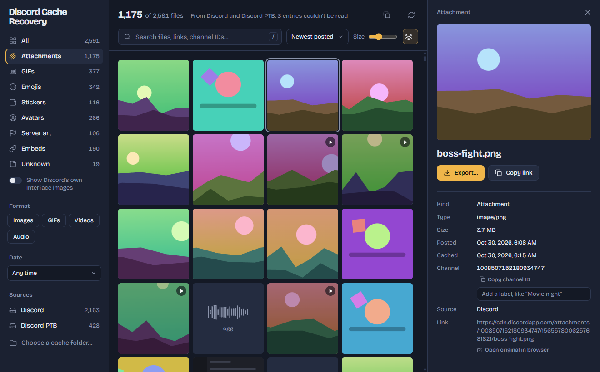

<p align="center">
  
</p>

<h1 align="center">Discord Cache Recovery</h1>

<p align="center">
  Get back the images, GIFs, videos and emojis Discord left on your computer,<br>
  even after the original message, link or favorite GIF is gone.
</p>

<p align="center">
  <a href="../../releases/latest"><b>Download</b></a> ·
  Windows · macOS · Linux · Free and open source
</p>

<p align="center">
  
</p>

---

- **Find it again.** Everything Discord cached shows up in one gallery: attachments, GIFs from the
  picker, emojis, stickers, avatars, server icons and link previews.
- **Real names, links and dates.** Attachments keep their original file name, and every file shows
  the link it came from and when it was posted (decoded from Discord's IDs) or downloaded.
- **Search and filter** by name, link or channel ID, by kind, format and date. Give channels your
  own names ("Movie night") to search by them.
- **Export** one file or a whole selection. Exported files keep their original name and date.
- **Fast.** Thousands of cached files are indexed in seconds, without reading whole files.

Works with Discord, PTB, Canary and Development, including Flatpak and Snap installs on Linux.
You can also open a cache folder you copied from another computer.

## Is it safe? Can it get my account banned?

The app works **entirely offline**. It never logs in, never uses your account or token, never
talks to Discord's servers and never modifies Discord. It only reads files Discord already saved on
your computer, the same way a file browser would. The source code is all here.

## Install

Download the latest build from the [Releases](../../releases/latest) page:

| System | File |
|---|---|
| Windows | `…_x64-setup.exe` (`…_arm64-setup.exe` on ARM PCs) |
| macOS | `…_aarch64.dmg` for Apple Silicon (M1 and later), `…_x64.dmg` for Intel |
| Linux | `.AppImage` (any distro), `.deb` (Debian/Ubuntu) or `.rpm` (Fedora) |

The builds aren't code-signed, so the first launch needs one extra step:

- **Windows**: SmartScreen says "Windows protected your PC" → **More info → Run anyway**.
- **macOS**: if it says the app is damaged or can't be opened, run this once in Terminal:
  `xattr -cr "/Applications/Discord Cache Recovery.app"`

## Using it

1. Open the app. It finds your Discord installs and scans their cache right away.
2. Narrow it down with the sidebar (Attachments, GIFs, Emojis…), the date filter or the search box.
   Press <kbd>/</kbd> to jump to search.
3. Click a file to see its details: original name, link, posted and cached dates, channel.
4. **Export…** saves it. To save several, <kbd>Ctrl</kbd>-click (or <kbd>Shift</kbd>-click) them,
   or <kbd>Ctrl</kbd>+<kbd>A</kbd> for everything you've filtered, then **Export** in the bar at the
   bottom.

If the app says Discord has its cache locked (Windows), quit Discord completely: right-click its
tray icon → **Quit Discord**, then **Rescan**.

## FAQ

**I can't find the image or GIF I'm looking for.**
The app can only recover what's still in the cache. Discord removes old entries as the cache fills
up, and clearing the cache deletes everything. Try turning off **Group sizes**, widen the date
filter, and switch on **Show Discord's own interface images** in case it's filed there.

**Can it tell which server or favorite-GIF tab something came from?**
Not directly; that isn't stored with the cached files. Attachments include the channel ID, so you
can label channels yourself. In Discord, turn on Developer Mode, right-click a channel and choose
**Copy Channel ID**.

**Where is Discord's cache?**

| | Folder |
|---|---|
| Windows | `%APPDATA%\discord\Cache\Cache_Data` |
| macOS | `~/Library/Application Support/discord/Cache/Cache_Data` |
| Linux | `~/.config/discord/Cache/Cache_Data` (Flatpak: `~/.var/app/com.discordapp.Discord/config/discord/…`) |

PTB, Canary and Development use `discordptb`, `discordcanary` and `discorddevelopment` instead of
`discord`.

**Something looks wrong.**
Click **Copy scan details** in the top right and paste it into an
[issue](../../issues). It contains counts only, no file names, links or contents.

## Development

Tauri 2 (Rust) with Svelte 5 and TypeScript. How the cache is parsed is documented in
[docs/ARCHITECTURE.md](docs/ARCHITECTURE.md).

Requirements: [Node](https://nodejs.org) 22+ and [Rust](https://rustup.rs) (stable), plus the
[Tauri prerequisites](https://v2.tauri.app/start/prerequisites/) for your OS.

```bash
npm install
npm run tauri dev
```

`npm run dev` runs only the interface in a browser, with generated sample data (`?mock=big`,
`?mock=locked`, `?mock=none` and `?mock=empty` show other states). `cd src-tauri && cargo test`
runs the parser tests. `npm run tauri build` makes an installer for your own OS in
`src-tauri/target/release/bundle/`.

### Download page

[`site/`](site/) is the download page: plain HTML with no build step. It's served by Cloudflare
Workers using [`wrangler.jsonc`](wrangler.jsonc); run `npx wrangler deploy` to publish it, or
connect the repo in Cloudflare so every push to `main` deploys it. Its download buttons read the
latest published release from the GitHub API.

### Releasing

[`.github/workflows/release.yml`](.github/workflows/release.yml) builds all six targets (Windows,
macOS and Linux, each on x64 and ARM64) and publishes them as a GitHub release once every build
has succeeded. Until then the release stays a draft, so nobody sees it with installers missing.

1. Bump `version` in [`src-tauri/tauri.conf.json`](src-tauri/tauri.conf.json) and commit.
2. Push a matching tag. The script checks the tag matches the version first:
   ```bash
   ./release.sh v4.1.0
   ```
3. In about 15 minutes the release is live and the download page links to the new installers. If
   a build fails, the draft stays on the Releases page: fix the problem and run the **Release**
   workflow again from the Actions tab (it reuses the draft).

## Credits

[@ggatesdew](https://github.com/ggatesdew) for testing on macOS.

Not affiliated with or endorsed by Discord Inc.

## License

MIT, see [LICENSE](LICENSE).
